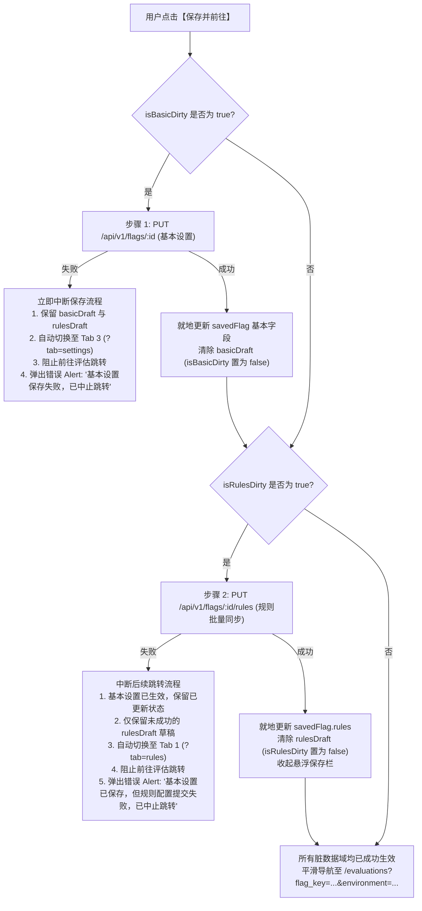
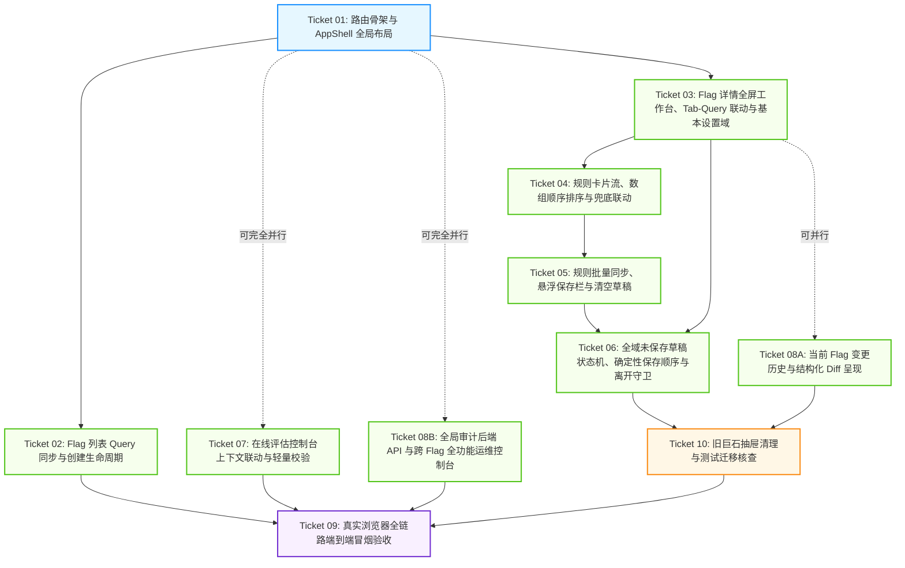

Status: resolved

# Feature Flag 平台前端 UI 布局迁移与渐进式重构规范说明书 (Spec v2.4)

## Problem Statement

当前 Feature Flag 平台的前端实现采用紧凑的“单页 State 切换 + 巨石抽屉”模式（根组件通过内部 `activeTab` 状态切换 Flag 列表与控制台，且全部 Flag 详情、规则配置、审计历史与基本信息均塞入单个超过 1000 行的抽屉组件 `FlagDetailDrawer.tsx` 中）。随着平台功能演进与用户体验要求的提高，用户与研发团队面临以下具体问题：
1. **信息架构受限且缺乏深层链接**：没有浏览器路由体系支持，用户无法通过 URL（如 `/flags/10?tab=audit` 或 `/evaluations?flag_key=checkout_v2`）直接分享、收藏或刷新定位页面；浏览器前进后退失效，刷新即丢失当前视图与选中 Tab。
2. **规则配置与操作边界模糊**：抽屉内部空间狭窄，多条规则以密集表格呈现，规则编辑与默认返回值同时存在提交入口，职责混淆且易引发误操作覆盖；规则优先级采用随意手填加排序并存，容易诱发唯一键冲突认知困惑。
3. **未保存草稿与导航逻辑矛盾**：用户在微调多条规则或调整次序时，一旦切换 Tab 或点击跳转控制台，极易误触丢失未保存草稿；若调整顺序后又恢复原状，缺乏确定性脏检查导致浮现无效保存提示；跨 Tab 查看时，未保存的基本设置与规则配置兜底缺乏明确的“生效值 vs 草稿值”状态表达。
4. **控制台与 Flag 详情割裂**：用户在配置好灰度规则后，前往在线评估控制台需要手动重新选择环境并完整输入 Flag Key，缺乏无缝的上下文自动流转与闭环联动。
5. **测试与质量保障体系脆弱**：先前测试过度依赖直接 Mock API Client 的业务方法（`vi.mock('../api/client')`），跳过了真实的 HTTP 请求构造、Query 序列化与 JSON 解包逻辑；同时缺少挂载完整路由树的集成验证与真实浏览器深层链接/刷新回退冒烟测试。

用户期望拥有一套符合企业级工程标准、具备清晰深层链接、职责边界分明、草稿与生效状态无歧义、上下文顺畅联动的专业管理平台。

## Solution

在完全遵循统一领域术语（`GLOSSARY.md`）与既有架构决策（ADR 0001~0006）的前提下，对前端实施渐进式 UI 布局迁移与重构：
1. **引入客户端声明式路由体系与 AppShell 全局骨架**：
   - 建立左侧固定全局导航栏（功能开关 `/flags`、规则评估 `/evaluations`、全局操作历史 `/audit-logs`）+ 顶部面包屑工作区 Header + 右侧主工作视口。
   - 实现 URL 深度路由支持与浏览器历史栈管理（刷新不丢路由、前进后退自如）。
2. **重构 Flag 详情为全屏标签工作台（Tabbed Workspace）并与 URL Query 深度绑定**：
   - 拆解原巨石抽屉为独立的 Flag 详情页面（`/flags/:id`），划分为统一 Flag Header（名称、环境 Tag、等宽 Key 复制、启停 Switch）、轻量信息摘要行（SummaryBar）及三大独立 Tab。
   - **Tab 与 URL Query 双向同步**：`?tab=rules`（规则配置）、`?tab=audit`（变更历史）、`?tab=settings`（基本设置），浏览器刷新或后退前进可无缝恢复 Tab 选中状态。
3. **严格区分已生效值与未保存草稿，明晰数据归属与兜底提示**：
   - **基本设置域**（名称、描述、默认返回值）：在 Tab 3 由独立表单维护，未保存时属于表单局部草稿，提交 `PUT /api/v1/flags/:id` 成功后才更新为已生效值。
   - **规则配置域**（规则增删改、排序）：在 Tab 1 由有序卡片流工作台维护，通过底部悬浮保存栏批量提交 `PUT /api/v1/flags/:id/rules`。
   - **兜底展示与草稿联动**：Tab 1 底部的默认返回值卡片固定为**只读兜底展示已生效值**（绝不提供编辑控件）；若检测到 Tab 3 存在未保存的默认返回值草稿，额外渲染黄色提示微章明确告知“存在未生效草稿”，杜绝把草稿误当生效配置。
   - **熔断启停域**：Header 状态开关即时原子提交 `PATCH /api/v1/flags/:id/toggle`，成功后以服务端最新 Flag 实体全量同步前端状态，失败即时回滚。
4. **数组顺序即执行优先级模型与无变动自动收起**：
   - 前端采用「**卡片草稿数组顺序即规则执行顺序**」模型，在纯前端内存中重新排布卡片数组，以数组位置作为执行优先级的唯一事实来源；
   - 悬浮保存栏展示与否严格基于 `isRulesDirty` 实际计算结果：**若用户调整顺序后又恢复原状，保存栏自动平滑收起**；无变动绝不发出无效网络请求，天然杜绝冗余审计日志；
   - 批量保存时，由前端根据数组次序统一自动生成严格合法的 `priority: index + 1`，彻底消除前端优先级重复冲突；后端在单事务内通过 `ShiftPriorities(..., 1000000)` 偏移机制彻底避免物理唯一索引冲突。
5. **全域真实脏检查状态机与确定性保存顺序守卫**：
   - 真实比对草稿与服务端已生效值的差异判定脏状态（`isBasicDirty` 与 `isRulesDirty`）；
   - 同一 Flag 内切换 Tab 静默保留内存草稿并在 Tab 标题增加星号提示，URL Query 同步更新 `?tab=...`，不弹出误触弹窗；
   - 从 Flag 详情跳转「规则评估」时，若有未保存草稿，弹出三选一弹窗：【保存并前往】、【放弃修改并前往】、【继续留在本页编辑】。
   - **保存并前往确定性执行顺序**：**先提交基本设置 (`PUT /flags/:id`)，后提交规则配置 (`PUT /flags/:id/rules`)**。若第一步失败立即熔断，保留两个草稿并切换至 Tab 3；若第一步成功第二步失败，将已生效的基本设置更新入 `savedFlag` 并清除其脏标记，保留未生效的规则草稿并切换至 Tab 1，中止页面跳转并展示明确错误 Alert。
6. **在线评估控制台的双向上下文深度流转与轻量交互**：
   - 聚焦打通独立「规则评估控制台」（`/evaluations`），利用 URL Query 双向传递 Flag Key 与环境参数作为默认预填值（不锁定字段，支持自由修改），进入控制台展现上下文横幅及【返回 Flag 详情】链接；
   - Context 输入框采用原生文本域结合 `JSON.parse` 实时语法校验，拦截畸变输入，不引入重型富文本编辑器。
7. **真实操作审计呈现与全局运维控制台协同交付**：
   - Flag 专属变更历史（Tab 2）直接基于后端现有单 Flag 接口呈现结构化变更 Diff（消费真实 `diff_summary`）；
   - 明确 Ticket 08A 与 08B 之间的共享解析契约：在 `frontend/src/utils/diffParser.ts` 中定义通用的 `parseAuditDiff` 纯函数接口；Ticket 08A 与 08B 保留独立并行开发，在 Ticket 09 中完成最终集成闭环；
   - 全局操作历史（`GET /api/v1/audit-logs`）协同交付后端端点，支持多维度过滤（环境、Flag Key 模糊搜索、**操作类型 `action_type`**）与分页；
   - 前端全局操作历史表格支持**展开查看变更 Diff 摘要**，点击 Flag Key 可**直达对应 Flag 详情的变更历史 Tab (`/flags/:id?tab=audit`)**。
8. **多层次严密测试保障体系**：
   - 设立生产级完整路由树集成测试接缝（MemoryRouter 挂载全量路由配置，MSW 拦截 HTTP 边界验证真实请求方法、URL、Query 与 Payload）；
   - 明确测试职责边界：核心 Engine 计算规则由后端已有完整单元测试承载，前端侧重于表单交互、轻量校验与三态结果卡片渲染；
   - 真实浏览器端到端冒烟测试（Ticket 09）**明确测试环境边界**：全栈链路直连隔离测试环境并**使用动态生成的随机测试 Key**（测试后执行数据清理）；纯前端回退与防误关场景使用受控 Mock；
   - 数据库事务原子性（SPEC-US 32）严禁由前端 Mock 代替，明确引用后端真实数据库回滚测试（`TestFlagService_AtomicRollback_OnAuditFailure`）并在 Ticket 05 中补充规则批量同步事务回滚测试；
   - 清理旧抽屉时严格执行测试覆盖迁移核对，确保旧功能测试 100% 被新套件继承。

---

## 需求基线与用户故事 (Authoritative Requirements Baseline: docs/SPEC.md US 01~35)

### 一、 原始需求基线 (Single Source of Truth: docs/SPEC.md)

#### Flag 生命周期管理
- **SPEC-US 01**: 作为研发人员，我想要在特定环境（development、staging 或 production）下创建一个在当前环境下具备唯一 Key、名称、可选描述及默认返回值的 Flag，以便为新功能接入特性开关。
- **SPEC-US 02**: 作为研发人员，我想要在不同环境中使用相同的 Flag Key，以便在开发、测试与生产环境中保持一致的代码调用逻辑。
- **SPEC-US 03**: 作为配置管理员，我想要在试图于同一环境下创建重复 Flag Key 时收到明确的冲突提示（`FLAG_KEY_CONFLICT`），以便避免配置覆盖事故。
- **SPEC-US 04**: 作为配置管理员，我想要查看按环境筛选或按关键字搜索的 Flag 列表，以便快速定位需要维护的特性开关。
- **SPEC-US 05**: 作为配置管理员，我想要查看 Flag 的详细信息（包含基础信息、生效环境、启停状态、默认返回值、创建/更新时间），以便全面了解开关现状。
- **SPEC-US 06**: 作为配置管理员，我想要编辑 Flag 的基本信息（名称、描述、默认返回值），以便在业务策略调整时更新配置。
- **SPEC-US 07**: 作为运维人员，我想要一键切换 Flag 的启用或停用状态，以便在突发故障时实现毫秒级功能熔断。
- **SPEC-US 08**: 作为系统用户，我想要在停用 Flag 时确保系统始终返回 `false` 且评估原因标识为 `FLAG_DISABLED`，以便消除停用开关对下游业务的不确定影响。

#### 有序规则配置与批量同步
- **SPEC-US 09**: 作为产品经理，我想要为 Flag 配置多条有序匹配规则，以便针对特定用户群体实施灰度放量。
- **SPEC-US 10**: 作为产品经理，我想要为规则指定属性名、操作符（`equals` 或 `in`）、期望值以及命中后的布尔返回值，以便精确描述灰度条件。
- **SPEC-US 11**: 作为配置管理员，我想要为每条规则指定唯一的正整数优先级（1 表示最高优先级），以便确定规则判断的执行次序。
- **SPEC-US 12**: 作为配置管理员，我想要在配置重复优先级时被前端界面与后端接口严格拦截（`PRIORITY_CONFLICT`），以便杜绝执行次序的歧义。
- **SPEC-US 13**: 作为配置管理员，我想要一次性批量提交 Flag 的全部规则更新（包括新增、修改、删除以及优先级的原子重排与互换），以便在单次操作中安全保存整组规则配置。
- **SPEC-US 14**: 作为配置管理员，我想要在清空 Flag 全部规则前进行二次确认，并在提交后安全删除全部规则且生成准确的删除审计记录，以便防止误操作导致所有灰度策略失效。
- **SPEC-US 15**: 作为安全审计员，我想要在批量更新规则时由系统自动校验规则 ID 归属（必须全量归属于当前 Flag，且请求内禁止存在重复规则 ID），以便防止恶意请求跨 Flag 篡改规则。
- **SPEC-US 16**: 作为系统用户，我想要在批量更新规则且内容无任何变动时（包括在无规则状态下重复提交空规则列表），系统自动跳过审计日志写入，以便避免产生无意义的冗余历史记录。

#### 规则评估引擎 (Backend Core Calculation)
- **SPEC-US 17**: 作为调用方服务，我想要传入 Flag Key、环境和包含用户属性的 JSON 上下文发起评估，以便决定是否对该用户开放特性。
- **SPEC-US 18**: 作为调用方服务，我想要规则评估严格按照优先级数值升序逐条判断，并在第一条规则命中时立即短路返回，以便获得确定且高效的计算结果。
- **SPEC-US 19**: 作为调用方服务，我想要在没有规则命中时由系统自动回退返回 Flag 的默认布尔值，并标记原因为 `DEFAULT_FALLBACK`。
- **SPEC-US 20**: 作为测试人员，我想要 `equals` 操作符执行严格 JSON 类型隔离（string、number、boolean 严禁跨类型匹配）与数值大小精确匹配，期望值必须为非 null 标量；属性缺失或为 null 时判定不命中。
- **SPEC-US 21**: 作为测试人员，我想要 `in` 操作符在期望值为非空标量数组时执行精确类型与数值匹配；当属性缺失或为 null 时判定不命中。
- **SPEC-US 22**: 作为系统用户，我想要当用户属性缺失或属性类型与期望值不一致时，当前规则判定为不命中并平滑评估下一条规则，以便提高规则容错性。
- **SPEC-US 23**: 作为系统用户，我想要在传入非法 JSON、缺失必填字段或请求不存在的 Flag 时获得规范的错误响应（`VALIDATION_ERROR` 或 `FLAG_NOT_FOUND`），以便快速排查调用错误。

#### 在线评估控制台
- **SPEC-US 24**: 作为产品经理或测试人员，我想要在控制台中选择环境、输入 Flag Key 并粘贴测试用户属性 JSON，以便直观验证灰度规则的配置效果。
- **SPEC-US 25**: 作为测试人员，我想要在控制台中清晰看到最终返回值（true/false），以便确认评估结果。
- **SPEC-US 26**: 作为测试人员，我想要在控制台中明确获知是否命中了规则，以及具体命中哪一条规则（显示属性名、操作符、期望值和优先级），以便解释决策链路。
- **SPEC-US 27**: 作为测试人员，我想要在未命中任何规则时看到明确说明“未命中规则，回退至默认返回值”，以便理解非命中原因。
- **SPEC-US 28**: 作为前端用户，我想要在输入不合法的 JSON 时获得前端实时的语法错误提示与友好的错误反馈，以便及时修正输入。

#### 变更历史与审计追溯
- **SPEC-US 29**: 作为合规审计员，我想要查看 Flag 的所有变更历史，包括创建、基本信息修改、规则批量同步及启停切换，以便追溯每次配置变更。
- **SPEC-US 30**: 作为合规审计员，我想要在规则批量同步的审计记录中清晰查看精确的规则差异摘要（新增了哪些规则、修改了哪些字段、删除了哪些规则），以便快速比对改动细节。
- **SPEC-US 31**: 作为合规审计员，我想要审计日志包含操作类型、发生时间、变更摘要以及冗余记录的 Flag Key 和环境，以便即使主配置演进也能保持审计记录的完整可读性。
- **SPEC-US 32**: 作为架构师，我想要确保业务数据持久化与 Audit Log 写入在同一个数据库显式事务中执行，任一环节失败全量回滚，以便保证审计与业务状态的绝对一致。

#### 运行复现与部署
- **SPEC-US 33**: 作为评测人员，我想要通过 README 提供的少量明确命令在本地顺利启动前后端与数据库，以便低成本直接复现与调试系统。
- **SPEC-US 34**: 作为评测人员，我想要支持使用推荐的 Docker Compose 一键拉起全栈服务，以便在纯净容器环境中自动化验证系统功能。
- **SPEC-US 35**: 作为评测人员，我想要在系统首次启动时自动加载演示数据（包含不同环境下的 Flag、有序规则及初始审计记录），以便开箱即用验证核心业务链路。

---

### 二、 前端架构与交互重构增量规范 (UI Refactor Specifications UI-R 01~13 权威定义)

- **UI-R 01 (全局导航体系)**: 系统具备左侧固定的全局导航栏（功能开关 `/flags`、规则评估 `/evaluations`、全局操作历史 `/audit-logs`）与顶部面包屑导航，支持直接点击回跳。
- **UI-R 02 (深层链接与 SPA 回退)**: 所有工作区均具备独立浏览器 URL 地址，支持通过 URL 分享、收藏，按 F5 刷新在生产 Nginx 环境下通过 `try_files` 稳定回退到 `index.html` 不报 404。
- **UI-R 03 (列表 Query 状态同步)**: Flag 列表页的环境过滤与搜索关键字实时双向同步至 URL Query（`?environment=...&search=...`），刷新时自动恢复过滤态。
- **UI-R 04 (全屏工作台取代抽屉)**: Flag 详情与规则配置整体迁移为全屏工作台页面（`/flags/:id`），彻底替代原 1000 行巨石抽屉组件。
- **UI-R 05 (详情页 Tab 与 URL Query 双向绑定)**: Flag 详情页三大 Tab 状态与 URL Query 深度绑定（`?tab=rules|audit|settings`），刷新页面或浏览器后退前进时精准恢复激活 Tab。
- **UI-R 06 (统一启停 Toggle 交互与防重)**: 列表行内 Switch 与详情 Header Switch 逻辑统一：点击调用 `PATCH /flags/:id/toggle`，期间禁用防并发重复点击，成功后以服务端返回的最新完整 Flag 实体同步状态，失败即时回滚。
- **UI-R 07 (卡片流与数组顺序排序)**: 规则配置以卡片流纵向排布，通过“上移”/“下移”调整本地数组顺序，以数组相对位置作为优先级的唯一事实来源；保存时前端自动生成连续且无重复的合法优先级（`priority: index + 1`）。
- **UI-R 08 (悬浮保存与原值恢复自动收起)**: 任何规则变动均作为本地草稿管理，底部平滑浮现悬浮保存栏。悬浮栏是否激活以实际计算的 `isRulesDirty` 为准；**若用户微调顺序后又恢复原状，保存栏自动收起**；“清空全部规则”经二次确认后仅将本地草稿置为 `[]` 并标记 Dirty，统一通过悬浮栏提交。
- **UI-R 09 (只读兜底与草稿联动提示)**: 规则工作台底部默认值兜底卡片严格只读展示已生效值；若基本设置中存在未生效草稿，右侧渲染黄色警告徽标明确提示。
- **UI-R 10 (全域真实脏检查状态机)**: 基于内容差异判定真实脏状态（`isBasicDirty` 与 `isRulesDirty`）。同一 Flag 内切换 Tab 静默保留草稿并在 Tab 标题添加未保存星号（`*`）。
- **UI-R 11 (确定性保存顺序与部分失败容错)**: 存在未保存草稿离开 Flag 触发拦截；前往在线评估弹出三选一弹窗，保存并前往严格按照“**先基本设置、后规则配置**”的确定性顺序执行，若出现部分成功部分失败，已成功部分就地更新、未成功部分保留草稿，中止跳转停留在失败 Tab 并展示明确错误 Alert。
- **UI-R 12 (评估控制台默认回填与轻量校验)**: 在线评估控制台从 URL Query 读取环境与 Key 作为默认初始值（允许用户修改）；用户属性 Context 采用标准文本域结合原生 `JSON.parse` 校验，拦截语法错误，不引入重型富文本编辑器。
- **UI-R 13 (全局运维审计全功能控制台)**: 后端提供 `GET /api/v1/audit-logs`（返回数据包含 `flag_id`），支持分页、环境过滤、Key 搜索及**操作类型 (`action_type`) 筛选**；前端支持**展开查看变更 Diff 摘要**，点击 Flag Key 可**直达对应 Flag 详情的变更历史 Tab (`/flags/:id?tab=audit`)**。

---

## 核心实现机制规范 (Key Implementation Decisions)

### 1. 真实脏检查与全域未保存状态机 (True Dirty State Machine)

为避免单纯基于 `draft !== null` 产生的误报（例如用户调换规则后又换回原位），建立基于实际内容深比对的脏检查模型：

```typescript
// 1. 基本设置脏检查：对比表单当前值与服务端已持久化值
const isBasicDirty = Boolean(
  basicDraft && (
    basicDraft.name !== savedFlag.name ||
    basicDraft.description !== (savedFlag.description ?? '') ||
    basicDraft.default_value !== savedFlag.default_value
  )
);

// 2. 规则配置脏检查：比对本地草稿数组与服务端规则数组（长度、元素字段、数组顺序）
const isRulesDirty = Boolean(
  rulesDraft && !isRulesEqual(rulesDraft, savedFlag.rules)
);

// 3. 全域未保存判定
const hasUnsavedChanges = isBasicDirty || isRulesDirty;
```

- **悬浮保存栏联动**：悬浮保存栏的显示与否纯粹绑定 `isRulesDirty`。当用户上移规则 A 随后下移回原位，`isRulesDirty` 自动变为 `false`，保存栏平滑自动收起，杜绝误导用户提交无意义变更。
- **空变更抑制契约**：当 `!isRulesDirty` 时，前端禁用保存按钮，不向后端发出任何网络请求，天然杜绝空变更审计记录写入（闭环 SPEC-US 16）。

---

### 2. 前往评估【保存并前往】确定性执行顺序与部分失败容错

当用户在 Flag 详情页 Header 点击“前往在线评估”且 `hasUnsavedChanges` 为 true 时弹出三选一弹窗。若用户选择【保存并前往】，前端必须严格执行以下**确定性串行保存顺序**：



---

### 3. Flag 详情 Tab 状态与 URL Query 双向同步机制

- **Query 参数规范**：
  - `/flags/:id?tab=rules` -> 激活“规则配置”Tab
  - `/flags/:id?tab=audit` -> 激活“变更历史”Tab
  - `/flags/:id?tab=settings` -> 激活“基本设置”Tab
  - 若 URL 中缺少 `tab` 参数或传入未知参数，默认激活 `rules` Tab。
- **双向流转行为**：
  - 点击 Tab 切换时：通过 `setSearchParams({ tab: key })` 更新当前 URL，静默保留 `rulesDraft` 与 `basicDraft`（Tab 标题保留 `*` 星号）；
  - 刷新页面（F5）：从当前 URL Query 解析 `tab` 参数并恢复激活对应 Tab，保证心智连续；
  - 浏览器后退/前进：响应 URL Query 变化并同步切换 Tab 显示；
  - 全局操作历史点击：从 `/audit-logs` 点击 Flag Key 链接，直接导航至 `/flags/${flag_id}?tab=audit`，一键直达当前 Flag 的变更历史。

---

### 4. 共享 parseAuditDiff 接口契约与 Ticket 08A/08B 解耦方案

为确保 Ticket 08A 与 08B 可完全并行开发而不产生代码冲突或接口分歧，提前在 `frontend/src/utils/diffParser.ts` 设立统一的数据类型与解析接口契约：

```typescript
export interface ParsedAuditDiff {
  action: 'created' | 'updated' | 'toggled' | 'rules_synced' | 'unknown';
  flagUpdate?: {
    before: { name?: string; description?: string; default_value?: boolean };
    after: { name?: string; description?: string; default_value?: boolean };
  };
  flagToggle?: {
    old_enabled: boolean;
    new_enabled: boolean;
  };
  ruleDiff?: {
    added: Array<{ attribute_name: string; operator: string; expected_value: unknown; return_value: boolean; priority: number }>;
    updated: Array<{ id: number; before: Record<string, unknown>; after: Record<string, unknown> }>;
    deleted: Array<{ attribute_name: string; operator: string; expected_value: unknown; return_value: boolean; priority: number }>;
  };
}

export function parseAuditDiff(rawDiff: unknown): ParsedAuditDiff;
```

- **并行协作机制**：
  - 由 Ticket 08A 负责创建 `frontend/src/utils/diffParser.ts` 及其单元测试 `diffParser.test.ts`，并在 Flag 详情 Tab 2 垂直时间轴中渲染；
  - Ticket 08B 遵循上述预定义契约，在全局表格的 `expandable` 行展开中使用同一函数渲染 Diff 摘要；若 08B 先行合并，使用纯函数存根保证编译与测试通过；
- **集成验收条件**：在 Ticket 09 启动前，验证 08A 与 08B 均引用该公共模块，无重复实现或类型分歧。

---

### 5. 后端事务原子性保障 (SPEC-US 32) 与 Engine 测试证据规范

- **SPEC-US 32 后端真实数据库事务责任**：
  - 严禁用前端 MSW 测试代替数据库事务原子性验证；
  - 核心持久化与审计写入均运行在显式事务 `flagRepo.WithTransaction` 中；
  - **已验证真实后端测试**：[`backend/internal/service/flag_service_test.go:323`](file:///Users/melody/Desktop/滴滴/backend/internal/service/flag_service_test.go#L323) 的 `TestFlagService_AtomicRollback_OnAuditFailure` 针对真实 PostgreSQL 验证了当审计日志创建失败时，Flag 基本信息与启停更新必须完整回滚；
  - **补充后端测试任务 (Ticket 05)**：在 `backend/internal/service/rule_service_test.go` 中补充 `TestRuleService_SyncRules_AtomicRollback_OnAuditFailure`，验证当规则批量同步过程中 AuditLog 写入失败时，整组规则的增删改与优先级偏移全量回滚。
- **后端 Engine 核心用例证据与分支覆盖**：
  - 杜绝以文件行数代替覆盖证据，后端 [`backend/internal/engine/engine_test.go`](file:///Users/melody/Desktop/滴滴/backend/internal/engine/engine_test.go) 实际包含的具体业务分支用例清单：
    1. `TestEvaluationEngine_DisabledFlag`：验证开关停用时立即短路并强制返回 `false` 与 `FLAG_DISABLED`（SPEC-US 08）；
    2. `TestEvaluationEngine_DefaultFallback`：验证规则为空或全量未命中时回退默认布尔值与 `DEFAULT_FALLBACK`（SPEC-US 19）；
    3. `TestEvaluationEngine_PriorityAndShortCircuit`：验证规则严格按 `priority` 升序判定并执行首命中短路求值与 `RULE_MATCH`（SPEC-US 18）；
    4. `TestEvaluationEngine_StrictTypeIsolationAndNumericalComparison`：验证：
       - `equals` 跨类型隔离（数字 `1` 与字符串 `"1"` 不命中，布尔 `true` 与 `"true"` 不命中）；
       - 数值精确比对（`1` 与 `1.0` 相等、大整数精度与浮点匹配）；
       - `in` 标量数组包含匹配与非法结构拦截（SPEC-US 20, 21）；
    5. `TestEvaluationEngine_MissingAttributeSkipsToNextRule`：验证用户属性缺失或为 `null` 时当前规则判定为不命中并平滑评估下一条（SPEC-US 22）。

---

### 6. Playwright 测试环境边界与测试数据隔离规范 (Ticket 09)

- **环境边界划分**：
  - **全栈真实集成链路 (Full-Stack Real API)**：深层链接直达、数据拉取、页面切换等端到端场景直连后端 Go 服务与 PostgreSQL，严禁使用前端客户端 Mock；
  - **纯前端与浏览器特性场景 (Client-Only / Browser Feature)**：Nginx `try_files` SPA 回退、浏览器前进/后退缓存导航、原生 `beforeunload` 防误关弹窗验证，可通过受控的网络拦截或纯客户端操作触发；
- **测试数据隔离与随机 Key 策略**：
  - 严禁硬编码 `/flags/1`；
  - 测试套件在初始化阶段通过 API 动态生成唯一随机 Flag Key：`smoke_${Date.now()}_${Math.random().toString(36).slice(2, 7)}`；
  - 基于真实返回的 `createdFlag.id` 开展深层链接（`/flags/${id}?tab=audit`）及刷新测试；
  - 在 `afterAll` 钩子中执行测试数据物理或逻辑清理，确保测试完全幂等。

---

## 依赖拓扑图 (Dependency Graph)



---

## 修订后的 Ticket 清单 (Revised Tickets Breakdown)

### Ticket 01: 客户端声明式路由体系、AppShell 全局骨架与本地运行支持
- **Blocked by:** None (可立即启动)
- **What to build:**
  - 安装并配置 `react-router-dom`，基于 `createBrowserRouter` 建立声明式路由配置（包含 `/flags`、`/flags/:id`、`/evaluations`、`/audit-logs`）；
  - 构建企业级 `AppShell` 骨架：固定左侧主导航栏、顶部动态面包屑 Header 及主工作视口 `Outlet`；
  - 访问根路径 `/` 自动重定向至 `/flags`；
  - 确保本地直接启动运行环境就绪（SPEC-US 33）：配置 Vite 本地代理 `/api` 转发至后端 `8080`；验证 `npm --prefix frontend dev` 与 `npm --prefix frontend build` 正常执行；
  - 在 `frontend/nginx.conf` 中确认配置 `try_files $uri $uri/ /index.html;`；
  - 搭建完整路由树测试接缝（挂载生产路由的 `MemoryRouter` 脚手架），编写首批路由重定向与面包屑计算的集成测试。
- **核心验收标准 (SPEC-US 33; UI-R 01, 02):**
  - [ ] 浏览器访问根路径 `/` 自动跳转至 `/flags`
  - [ ] 点击侧边导航菜单各栏目，URL 路径精准变化且左侧高亮状态同步更新
  - [ ] 面包屑随路由层级动态渲染可点击链接（如：功能开关 / 详情）
  - [ ] 本地执行 `npm run build` 打包成功，本地开发服务器顺利代理 API 请求
  - [ ] 挂载完整路由树的集成测试覆盖路径切换、面包屑生成与重定向

---

### Ticket 02: Flag 列表页 Query 双向同步、Flag 创建生命周期与行内启停
- **Blocked by:** Ticket 01 (与 Ticket 03, 07, 08B 并行推进)
- **What to build:**
  - `FlagListPage` 改造：环境过滤与关键字搜索与 URL Query（`?environment=...&search=...`）双向绑定，刷新或带参访问时自动恢复过滤态；
  - 验证首次启动演示数据（SPEC-US 35）：核实列表正常展示 `checkout_v2` 等系统初始演示 Flag；
  - 补齐并完善 Flag 创建生命周期（`CreateFlagDrawer` / 创建表单）：
    - 录入 Key、环境、名称、描述与默认返回值，调用 `POST /api/v1/flags`；
    - 同一环境重复创建 Key 时明确捕获 `FLAG_KEY_CONFLICT` 错误码并友好提示；
    - 不同环境允许使用相同 Key 成功创建；
    - 创建成功后自动无感知刷新列表，并可平滑进入全屏详情；
  - 统一行内启用/停用 Switch 逻辑：调用 `PATCH /api/v1/flags/:id/toggle`，防并发连击（请求中置为 loading 禁用），请求成功用服务端返回数据精准更新列表项，失败回滚 Switch 状态并提示错误；
  - 遵循 SPEC-US 32：确认后端创建与启停均在显式单事务内提交，引用后端真实测试 `TestFlagService_AtomicRollback_OnAuditFailure` 验证原子性；
  - 点击列表项整行或操作列“详情”链接，平滑路由导航至 `/flags/:id` 全屏工作台；
  - 路由集成测试：覆盖 Query 同步、Flag 创建冲突/成功、行内启停及跳转详情。
- **核心验收标准 (SPEC-US 01, 02, 03, 04, 07, 32, 35; UI-R 03, 06):**
  - [ ] 切换环境或输入搜索词，URL Query 实时同步且列表触发过滤加载
  - [ ] 携带 Query 刷新页面能准确恢复过滤态与列表数据
  - [ ] 新建 Flag 表单提交调用 `POST /api/v1/flags`，在同一环境下重复 Key 提示冲突错误，在不同环境复用 Key 创建成功
  - [ ] 列表行内 Switch 点击正确发送 `{ enabled: !current }`，成功后以服务端最新数据更新行，失败回滚
  - [ ] 点击列表项路由跳转至 `/flags/:id` 全屏工作台
  - [ ] 路由集成测试覆盖上述全量场景

---

### Ticket 03: Flag 详情全屏工作台框架、Tab-Query 双向同步与基本设置域
- **Blocked by:** Ticket 01 (与 Ticket 02, 07, 08B 并行推进)
- **What to build:**
  - 建立全屏详情页 `/flags/:id`：
    - `FlagHeader`：展示名称、环境 Tag、等宽 Key 及复制剪贴板按钮；集成启停 Switch（复用统一启停语义，防并发连击，成功用服务端返回值更新 `savedFlag`，失败回滚）；
    - `SummaryBar`：轻量展示规则总数、已生效默认返回值徽标及最后修改时间；
    - **Tab 与 URL Query 双向绑定**：提供 `rules`、`audit`、`settings` 三 Tab，与 `?tab=...` 实时双向同步，刷新或前进后退准确恢复激活 Tab；
  - 实现 Tab 3 基本设置工作台（`BasicSettingsTab`）：
    - 维护 Flag 名称、描述与默认布尔返回值的表单及局部草稿 `basicDraft`；
    - 提供独立的“保存设置”按钮提交 `PUT /api/v1/flags/:id`，与规则批量更新彻底解耦；
    - 遵循 SPEC-US 32：后端在显式单事务内原子更新 Flag 基本信息与 `FLAG_UPDATED` 审计记录；
    - 保存成功后原子更新 `savedFlag`，Header 标题与 SummaryBar 即时刷新为新生效值并清空 `basicDraft`；
  - 编写详情页深层链接直达、带 Tab 刷新与基本设置独立提交的路由集成测试。
- **核心验收标准 (SPEC-US 05, 06, 07, 32; UI-R 04, 05, 06):**
  - [ ] 直接访问 `/flags/:id` 正常拉取 Flag 详情并完整渲染 Header 与 SummaryBar
  - [ ] 切换 Tab 时 URL Query 同步变为 `?tab=rules|audit|settings`，刷新页面准确恢复选中 Tab
  - [ ] 点击 Key 旁复制按钮将 Flag Key 写入剪贴板并提示复制成功
  - [ ] Header 启停 Switch 即时调用 toggle 端点，成功更新实体，失败回滚
  - [ ] Tab 3 修改名称并保存，发送 `PUT /flags/:id`，成功后 Header 标题即时更新
  - [ ] 路由集成测试覆盖数据拉取、Tab 状态恢复、启停切换与设置保存

---

### Ticket 04: 规则卡片流、数组顺序排序与只读兜底联动
- **Blocked by:** Ticket 03
- **What to build:**
  - 实现 Tab 1 规则配置工作台（`RuleWorkspaceTab`）：
    - 纵向卡片流展示规则，卡片显示属性名、操作符（`equals`/`in`）、期望值与返回值，卡片按草稿数组索引展示序号（01, 02...）；
    - 卡片“上移”/“下移”：纯前端调整本地 `rulesDraft` **数组顺序**（首项禁用上移，末项禁用下移），以数组位置作为执行优先级的唯一事实来源；
    - 真实脏状态联动：调整顺序后若恢复原顺序，`isRulesDirty` 自动变为 false；
    - 添加/编辑规则 Modal（`RuleFormModal`）：追加规则至数组末尾；期望值前端校验（`equals` 仅允许标量，`in` 仅允许非空标量 JSON 数组）；
    - 底部只读默认返回值兜底卡片：严格只读展示 `savedFlag.default_value`；若 `basicDraft` 存在未保存的默认值修改，渲染黄色警告徽标（“基本设置中有未生效草稿”），杜绝草稿当生效值误解；
  - 编写数组顺序调整纯函数测试与期望值格式校验器单元测试。
- **核心验收标准 (SPEC-US 09, 10, 11, 20, 21; UI-R 07, 08, 09):**
  - [ ] 规则以卡片流纵向渲染，卡片序号按数组顺序显式排布
  - [ ] 点击上移/下移在本地重排卡片数组，边界按钮正确禁用
  - [ ] 调整规则后又调回原状，`isRulesDirty` 自动复原为 false
  - [ ] 添加/编辑规则对标量和数组输入执行严格格式拦截与错误提示
  - [ ] 兜底卡片严格为只读状态，当 Tab 3 修改默认值未保存时显示醒目警示徽标
  - [ ] 单元测试覆盖数组重排与格式校验逻辑

---

### Ticket 05: 规则批量同步、悬浮保存栏与清空草稿
- **Blocked by:** Ticket 04
- **What to build:**
  - 构建底部悬浮保存栏（`FloatingSaveBar`）：其显示完全取决于 `isRulesDirty` 的实际计算结果；**一旦修改被调回原值，保存栏自动平滑收起**；
  - 悬浮栏“放弃修改”：撤销本地所有规则变更，重置 `rulesDraft` 为 `null` 并收起保存栏；
  - 悬浮栏“保存规则配置”：**根据当前 `rulesDraft` 数组顺序，自动生成合法且唯一的优先级序列（`priority = index + 1`）**，批量提交至 `PUT /api/v1/flags/:id/rules`；
  - 遵循 SPEC-US 16 与 SPEC-US 32：
    - 无实质变动不发请求；
    - 后端在显式单事务内执行原子替换并写入 `RULES_SYNCED` 审计记录；
    - 编写补充后端真实数据库事务测试：在 `backend/internal/service/rule_service_test.go` 中新增 `TestRuleService_SyncRules_AtomicRollback_OnAuditFailure`，验证审计写入失败时规则批量更新全量回滚；
  - 保存成功后更新 `savedFlag.rules`，清空草稿并收起保存栏；失败保留草稿不丢单；
  - “清空全部规则”交互规范：点击清空弹出危险二次确认 Modal，**确认后仅将本地 `rulesDraft` 设为 `[]` 并触发 `isRulesDirty = true`**，悬浮保存栏浮现；用户点击悬浮栏“保存规则配置”后向后端提交 `{"rules": []}`；保存成功后展示规范的无规则空状态卡片；
  - 路由集成测试验证批量保存 Payload 结构、空变更不提交与清空保存。
- **核心验收标准 (SPEC-US 12, 13, 14, 15, 16, 32; UI-R 07, 08):**
  - [ ] 调整规则或清空规则后底部平滑浮现悬浮保存栏；调回原值后自动收起
  - [ ] 点击“放弃修改”恢复至服务端最新生效规则列表
  - [ ] 点击“清空全部规则”经二次确认后仅清空本地草稿，必须点击悬浮栏保存才真正发出空数组请求
  - [ ] 保存规则时 Payload 中的 priority 与数组顺序严格一致，无任何重复优先级
  - [ ] 补充并通过后端事务原子性测试 `TestRuleService_SyncRules_AtomicRollback_OnAuditFailure`
  - [ ] 服务端报错时保留正在编辑的草稿不丢失
  - [ ] 路由集成测试验证批量保存契约与空规则提交全绿

---

### Ticket 06: 全域真实脏检查状态机、确定性保存顺序与离开守卫
- **Blocked by:** Ticket 05, Ticket 03
- **What to build:**
  - 建立全域真实脏检查：
    - `isBasicDirty`：比对 `basicDraft` 与 `savedFlag` 实际字段差异；
    - `isRulesDirty`：比对 `rulesDraft` 与 `savedFlag.rules` 内容与次序差异；
    - `hasUnsavedChanges = isBasicDirty || isRulesDirty`；
  - 同一 Flag 内切 Tab：在规则配置、变更历史与基本设置之间切换，静默保留 `rulesDraft` 与 `basicDraft`，URL 同步更新 `?tab=...`，Tab 标题显示未保存星号徽标（如 `规则配置 *`、`基本设置 *`）；
  - Header 点击“前往在线评估”：
    - 若 `hasUnsavedChanges` 为 true，弹出三选一模态框：
      - **【保存并前往】**：严格按照**先基本设置 (`PUT /flags/:id`)，后规则配置 (`PUT /flags/:id/rules`)**的确定性顺序执行；
      - 若基本设置失败：立即中止，保留两个草稿，切至 Tab 3，阻止跳转并弹出错误；
      - 若基本设置成功但规则失败：就地更新 `savedFlag` 并清除 `basicDraft` 脏标记，保留未生效的 `rulesDraft`，切至 Tab 1，阻止跳转并弹出“基本设置已保存但规则失败”错误；
      - 若全部成功：清除所有草稿，顺畅跳转至 `/evaluations`；
      - 【放弃修改并前往】：放弃所有本地草稿并跳转；
      - 【继续留在本页编辑】：关闭弹窗停留在当前页；
  - 离开 Flag 守卫：存在任意未保存草稿时，点击面包屑返回、侧栏导航或浏览器后退，触发 React Router 离开确认弹窗；刷新或关闭浏览器触发原生 `beforeunload` 对话框；
  - 路由集成测试覆盖切 Tab 保留、确定性顺序提交、部分失败容错及离开拦截。
- **核心验收标准 (UI-R 10, 11):**
  - [ ] 实际修改内容时，对应 Tab 标题显示星号徽标；改回原值后星号自动消失
  - [ ] 详情页内切 Tab 不丢失表单或卡片修改，且不弹出打扰确认
  - [ ] 存在未保存草稿时点击前往评估，三选一弹窗按照“先基本设置后规则”顺序执行
  - [ ] 基本设置保存失败立即熔断；规则保存失败保留规则草稿且基本设置生效更新，阻止跳转
  - [ ] 尝试离开 Flag 页面时触发守卫弹窗拦截
  - [ ] 路由集成测试全绿

---

### Ticket 07: 在线评估控制台上下文联动、轻量校验与决策呈现
- **Blocked by:** Ticket 01 (与 Ticket 02~06 并行开发)
- **What to build:**
  - 改造 `EvaluationConsolePage`：页面挂载时读取 URL Query（`flag_key`、`environment`）作为环境和 Key 输入框的**默认初始值**（不锁定字段，用户可自由修改）；
  - 从 Flag 详情跳转进入时，顶部显示上下文提示横幅及【返回 Flag 详情】快速导流链接；直接从侧边栏进入时展示空白就绪表单；
  - 用户属性 Context 输入框采用原生文本域结合原生 `JSON.parse` 实时语法校验，语法错误时红色标红、展示解析错误原因并禁用“开始评估”按钮（不引入大型代码编辑器库）；
  - 评估结果卡片呈现：根据返回原因展示鲜明的规则命中（绿色 + 命中规则属性/操作符/期望值/优先级）、回退默认（中性 + 说明）与开关停用（橙色 + 熔断说明）三态卡片；
  - 引用后端已有核心计算用例覆盖证据（`TestEvaluationEngine_DisabledFlag`、`TestEvaluationEngine_DefaultFallback`、`TestEvaluationEngine_PriorityAndShortCircuit`、`TestEvaluationEngine_StrictTypeIsolationAndNumericalComparison`、`TestEvaluationEngine_MissingAttributeSkipsToNextRule`）；
  - 编写自动回填、语法校验拦截与三态结果呈现的前端路由集成测试。
- **核心验收标准 (SPEC-US 08, 17, 18, 19, 20, 21, 22, 23, 24, 25, 26, 27, 28; UI-R 12):**
  - [ ] 带参访问 `/evaluations?flag_key=...&environment=...` 自动回填环境与 Flag Key，且字段可编辑
  - [ ] 带参进入时顶部显示上下文横幅与【返回 Flag 详情】链接，点击平滑回跳
  - [ ] Context 输入畸变 JSON 时即时标红拦截并展示报错原因，禁用提交
  - [ ] 评估响应根据 `RULE_MATCH`、`DEFAULT_FALLBACK`、`FLAG_DISABLED` 精准渲染三态卡片
  - [ ] 路由集成测试覆盖回填、校验与三态结果卡片渲染

---

### Ticket 08A: 当前 Flag 变更历史垂直时间轴与结构化 Diff 呈现
- **Blocked by:** Ticket 03 (与 Ticket 04~07 并行开发)
- **What to build:**
  - 实现 Flag 详情 Tab 2 变更历史（`FlagAuditHistoryTab`）：消费已有的单 Flag 审计接口 `GET /api/v1/flags/:id/audit-logs`；
  - 垂直时间轴展示操作人标识（真实服务端返回，如 `admin`）、操作动作及发生时间；
  - 在公共工具库 `frontend/src/utils/diffParser.ts` 中建立共享解析契约并实现 `parseAuditDiff` 结构化解析器，对 `diff_summary` 进行分类渲染：
    - `RULES_SYNCED`：分类展开 `added`（新增规则）、`updated`（修改前与修改后的属性对比高亮）与 `deleted`（删除规则快照）；
    - `FLAG_UPDATED`：清晰比对名称、描述、默认返回值修改前后差异；
    - `FLAG_TOGGLED`：展示启停状态变更；
  - 编写 `parseAuditDiff` 纯函数单元测试与时间轴呈现的路由集成测试。
- **核心验收标准 (SPEC-US 29, 30, 31; UI-R 05):**
  - [ ] 访问 `/flags/:id?tab=audit` 正常拉取并呈现当前 Flag 的时间轴审计列表
  - [ ] 规则批量同步日志准确展开新增、修改（字段前后比对）、删除的结构化 Diff
  - [ ] 基本信息与启停日志准确呈现变更对比
  - [ ] 导出标准 `parseAuditDiff` 契约供 Ticket 08B 复用，单元测试与路由集成测试全绿

---

### Ticket 08B: 全局操作审计后端 API 与跨 Flag 全功能运维控制台
- **Blocked by:** Ticket 01 (与 Ticket 02~08A 完全并行开发)
- **What to build:**
  - 后端协同端点交付：
    - 在 `AuditRepository` 中实现 `ListAll(ctx, query)`（支持分页、按环境过滤、按 Flag Key 模糊搜索、**按操作类型 `action_type` 过滤**）；
    - 在 `FlagService` 中实现 `GetGlobalAuditLogs`；
    - 在 `FlagHandler` 中注册 `GET /api/v1/audit-logs`，返回包含 `flag_id` 的标准信封；
    - 编写 Go Handler & Service 针对真实 PostgreSQL 的单元测试；
  - 前端页面交付：
    - 实现 `GlobalAuditLogPage` 挂载于 `/audit-logs` 路由；
    - 接入真实 API Client 分页表格，支持环境过滤、Flag Key 模糊查询及**操作类型 (`action_type`) 筛选**；
    - **表格支持行展开 (Expandable Rows)**：引用 `frontend/src/utils/diffParser.ts` 契约的 `parseAuditDiff`，在展开行内查看详细规则与状态变更 Diff；
    - **直达 Flag 变更历史**：表格中 Flag Key 渲染为链接，点击跳转至 `/flags/${record.flag_id}?tab=audit`；
  - 编写全局审计页面的路由集成测试。
- **核心验收标准 (SPEC-US 31; UI-R 13):**
  - [ ] 后端 `GET /api/v1/audit-logs` 接口测试通过，支持 action_type 过滤且返回项显式包含 `flag_id`
  - [ ] 前端访问 `/audit-logs` 渲染真实分页表格，过滤、搜索与分页请求正常触发
  - [ ] 表格支持展开行查看结构化变更 Diff 摘要（复用 parseAuditDiff 共享契约）
  - [ ] 点击表格内的 Flag Key 链接直接跳转进入对应详情页变更历史 Tab `/flags/:id?tab=audit`
  - [ ] 前后端自动化测试全绿

---

### Ticket 10: 旧巨石抽屉 FlagDetailDrawer 清理与测试迁移核查
- **Blocked by:** Ticket 06, Ticket 08A (不依赖 Ticket 08B)
- **What to build:**
  - 严格核查原 `FlagDetailDrawer.test.tsx` 中 8 项关键测试覆盖在全新详情页与各子组件中的迁移完整度：
    1. 基础信息展示渲染 -> 迁移至 Ticket 03 集成测试；
    2. 基本设置表单更新与提交 -> 迁移至 Ticket 03 集成测试；
    3. 启停状态切换与错误回滚 -> 迁移至 Ticket 03 集成测试；
    4. 审计日志时间轴加载呈现 -> 迁移至 Ticket 08A 集成测试；
    5. 审计日志加载异常 Alert -> 迁移至 Ticket 08A 集成测试；
    6. 规则列表优先级排序渲染 -> 迁移至 Ticket 04 集成测试；
    7. 规则优先级互换并批量保存 -> 迁移至 Ticket 05 集成测试；
    8. 清空全部规则二次确认与保存 -> 迁移至 Ticket 05 集成测试；
  - 确认全量测试迁移覆盖后，安全删除 `frontend/src/components/FlagDetailDrawer.tsx`（1097 行）及旧测试文件；
  - 检查并清理各处旧引用与冗余代码；
  - 运行 `npm run build` 与 `npm test`，确保无编译告警且全量测试套件 Pass。
- **核心验收标准:**
  - [ ] 原 8 项关键业务测试已逐项在全新测试套件中得到继承验证
  - [ ] `FlagDetailDrawer.tsx` 及其旧测试文件已被完全移除，无残留调用
  - [ ] 前端 `npm run build` 打包完全成功，无 TS 类型错误
  - [ ] `npm test` 现有测试套件全量 Pass

---

### Ticket 09: 真实浏览器全链路端到端冒烟验收与运行复现
- **Blocked by:** Ticket 02, Ticket 07, Ticket 08B, Ticket 10 (作为最终验收道闸)
- **What to build:**
  - 验证本地启动（SPEC-US 33）：根据 README 执行 `npm --prefix frontend dev` 与 `go run backend/cmd/server/main.go`，本地启动并加载页面；
  - 验证容器化启动（SPEC-US 34）：执行 `docker compose up -d --build`，全栈服务拉起并健康就绪，端口 `3000` 正常访问；
  - 验证演示数据（SPEC-US 35）：核实首次启动时数据库自动载入演示 Flag 与初始审计；
  - 编写并执行 Playwright 真实浏览器端到端冒烟测试：
    1. **测试数据隔离与随机 Key**：测试初始化时动态通过 API 创建唯一测试 Flag（`smoke_${Date.now()}_...`），获取真实分配的 `id`，严禁硬编码 `/flags/1`；并在测试完成后清理数据；
    2. **深层链接直达与 Tab 恢复 (Deep Linking)**：浏览器直达 `/flags/${id}?tab=audit` 与 `/evaluations?flag_key=...&environment=...`，验证页面无白屏、正确拉取数据且 Tab 精准激活；
    3. **生产 Nginx SPA 路由回退验证**：在深层链接页面执行浏览器强制刷新（F5），断言 Nginx `try_files` 配置生效，页面正常恢复，不返回 404；
    4. **浏览器前进与后退历史栈**：从列表进入详情、再进入评估、连续后退与前进，验证 URL（含 `?tab=...`）与页面状态完全同步；
    5. **未保存防误关拦截**：在 Flag 详情页编辑规则后触发浏览器刷新，验证捕获原生 `beforeunload` 对话框；
    6. **纯前端场景与全栈场景边界分明**：全栈主链路直连真实后端与 PostgreSQL；纯前端防误关与 SPA 404 回退使用隔离用例；
  - 验证 Ticket 08A 与 08B 的公共 `parseAuditDiff` 最终集成无缝生效；
  - 统一对照原始 35 条 SPEC User Stories 与 UI 重构规范，确认 100% 验收达标。
- **核心验收标准 (SPEC-US 33, 34, 35; UI-R 02):**
  - [ ] 本地启动命令复现通过（SPEC-US 33）
  - [ ] Docker Compose 一键启动与 Nginx 转发验证通过（SPEC-US 34）
  - [ ] 演示数据首次启动自动就绪（SPEC-US 35）
  - [ ] Playwright 端到端浏览器测试全量通过（使用动态生成的随机 Flag Key）
  - [ ] Nginx 容器化 SPA 回退刷新测试通过
  - [ ] 原始 SPEC User Stories 验收要求全部满足

---

## 需求追踪矩阵 (Requirement Traceability Matrix)

| 需求编号 | 需求来源与核心摘要 | 承载工单 (Ticket) | 验证责任归属与测试接缝 |
| :---: | :--- | :---: | :--- |
| **SPEC-US 01** | 特定环境创建唯一 Key Flag | Ticket 02 | 前端集成测试：表单录入提交，MSW 捕获 POST 请求及 Payload 校验 |
| **SPEC-US 02** | 不同环境复用相同 Flag Key | Ticket 02 | 前端集成测试：分别选择 dev/prod 提交相同 Key 均成功 |
| **SPEC-US 03** | 同一环境重复 Key 拦截 (`FLAG_KEY_CONFLICT`) | Ticket 02 | 前端集成测试：MSW 返回 409，断言抽屉内 Alert 提示冲突 |
| **SPEC-US 04** | Flag 列表按环境筛选与关键字搜索 | Ticket 02 | 前端集成测试：切换环境 Segmented 与输入搜索词，校验 URL Query 与请求 |
| **SPEC-US 05** | 查看 Flag 详细信息 | Ticket 03 | 前端集成测试：直达 `/flags/:id`，断言 Header/SummaryBar 数据呈现 |
| **SPEC-US 06** | 编辑 Flag 基本信息 | Ticket 03 | 前端集成测试：修改名称保存，MSW 校验仅发出 PUT 请求且 Header 即时刷新 |
| **SPEC-US 07** | 一键切换 Flag 启停状态 | Ticket 02, 03 | 前端集成测试：点击 Switch，MSW 校验 PATCH 请求，断言防重与状态更新 |
| **SPEC-US 08** | 停用 Flag 时评估强制返回 false | Ticket 07 | 后端：`engine_test.go:TestEvaluationEngine_DisabledFlag` 计算覆盖；前端集成：断言橙色卡片与 `FLAG_DISABLED` |
| **SPEC-US 09** | 配置多条有序匹配规则 | Ticket 04 | 前端集成测试：添加多条规则卡片，断言垂直卡片流按数组顺序升序排列 |
| **SPEC-US 10** | 指定属性名、操作符、期望值与返回值 | Ticket 04 | 单元测试：`validateExpectedValue` 校验器；前端集成测试：模态框交互拦截 |
| **SPEC-US 11** | 每条规则指定唯一正整数优先级 | Ticket 04, 05 | 单元测试：数组顺序转优先级算法；前端集成：保存时生成连续合法优先级 |
| **SPEC-US 12** | 重复优先级严格拦截 (`PRIORITY_CONFLICT`) | Ticket 05 | 单元测试保证前端生成绝对无重；集成测试验证服务端 409 异常提示 |
| **SPEC-US 13** | 批量提交全部规则（含原子重排与互换） | Ticket 05 | 单元测试：数组重排算法；前端集成：下移后保存，MSW 校验 payload |
| **SPEC-US 14** | 清空全部规则二次确认与安全删除 | Ticket 05 | 前端集成：点击清空经确认进入空草稿，悬浮栏保存发出 `{"rules": []}` |
| **SPEC-US 15** | 批量更新自动校验规则 ID 归属 | Ticket 05 | 前端集成测试：提交非本 Flag 的规则 ID，MSW 返回 `VALIDATION_ERROR` 提示报错 |
| **SPEC-US 16** | 规则无变动时跳过审计日志 | Ticket 05 | 单元测试：草稿脏状态比对器；前端集成测试：调回原状时保存栏自动收起，不发请求 |
| **SPEC-US 17** | 传入 Key、环境及 Context 发起评估 | Ticket 07 | 前端集成测试：输入合法 JSON 上下文点击评估，MSW 校验 POST 请求载荷 |
| **SPEC-US 18** | 严格按优先级升序判断并短路求值 | Ticket 07 | 后端：`engine_test.go:TestEvaluationEngine_PriorityAndShortCircuit` 覆盖；前端集成：断言高优先级命中与绿色卡片 |
| **SPEC-US 19** | 全量未命中回退默认布尔值 | Ticket 07 | 后端：`engine_test.go:TestEvaluationEngine_DefaultFallback` 覆盖；前端集成：断言中性卡片与 `DEFAULT_FALLBACK` |
| **SPEC-US 20** | `equals` 严格类型隔离与精确比对 | Ticket 04, 07 | 后端：`engine_test.go:TestEvaluationEngine_StrictTypeIsolationAndNumericalComparison` 比对；前端单元：输入校验拦截 |
| **SPEC-US 21** | `in` 严格标量数组包含匹配 | Ticket 04, 07 | 后端：`engine_test.go:TestEvaluationEngine_StrictTypeIsolationAndNumericalComparison` 数组匹配；前端单元：数组输入校验拦截 |
| **SPEC-US 22** | 属性缺失或类型不符平滑下一条 | Ticket 07 | 后端：`engine_test.go:TestEvaluationEngine_MissingAttributeSkipsToNextRule` 跳过测试覆盖 |
| **SPEC-US 23** | 非法 JSON 实时语法错误拦截 | Ticket 07 | 前端单元测试：JSON 语法校验；前端集成：输入不闭合 JSON 红色标红禁用提交 |
| **SPEC-US 24** | 控制台环境与 Key 预置与回填 | Ticket 07 | 前端集成测试 & 浏览器冒烟：从 Header 点击跳转，Query 自动解析回填且允许修改 |
| **SPEC-US 25** | 控制台清晰看到最终返回值 | Ticket 07 | 前端集成测试：断言屏幕渲染的布尔值 Tag（true/false） |
| **SPEC-US 26** | 控制台明确获知命中规则与明细 | Ticket 07 | 前端集成测试：断言展示命中规则的属性、操作符、期望值与优先级 |
| **SPEC-US 27** | 控制台未命中展示回退说明 | Ticket 07 | 前端集成测试：断言渲染“未命中任何规则，回退至 Flag 默认值”说明文本 |
| **SPEC-US 28** | 控制台输入非法 JSON 实时反馈 | Ticket 07 | 前端集成测试：输入语法错误实时提示并阻止提交 |
| **SPEC-US 29** | 查看 Flag 变更历史 | Ticket 08A | 前端集成测试：访问 `?tab=audit` 完整展示创建、修改、规则同步与启停记录 |
| **SPEC-US 30** | 规则批量同步审计清晰查看 Diff | Ticket 08A | 单元测试：`parseAuditDiff`；前端集成测试：展开新增、修改对比与删除快照 |
| **SPEC-US 31** | 审计日志包含操作类型、时间与冗余标识 | Ticket 08A, 08B | 08A 覆盖时间轴操作与时间；08B 覆盖跨 Flag 全局表格渲染冗余 Key/Env |
| **SPEC-US 32** | 业务数据与 Audit Log 单显式事务提交 | Ticket 02, 03, 05 | 后端真实数据库事务测试：`flag_service_test.go:TestFlagService_AtomicRollback_OnAuditFailure` 及 Ticket 05 补充规则事务测试 |
| **SPEC-US 33** | 本地直接启动复现运行 | Ticket 01, 09 | 开发与冒烟验证：`npm --prefix frontend dev` + `go run backend/cmd/server/main.go` |
| **SPEC-US 34** | Docker Compose 一键拉起验证 | Ticket 09 | 容器冒烟验证：`docker compose up -d` 启动并运行 Playwright 验证端口 3000 与 Nginx 代理 |
| **SPEC-US 35** | 首次启动自动加载演示数据 | Ticket 02, 09 | 数据库与列表验证：`repository/seed_test.go:TestSeedDemoData_Idempotency` 验证种子幂等，前端列表展现初始演示 Flag |
| **UI-R 01** | 全局左侧固定导航与面包屑 | Ticket 01 | 路由集成测试：导航点击与面包屑计算 |
| **UI-R 02** | 深层链接直达与 SPA 刷新回退 | Ticket 01, 09 | 浏览器冒烟测试：F5 刷新不报 404，直达各子路径正常恢复 |
| **UI-R 03** | Flag 列表 Query 双向同步 | Ticket 02 | 路由集成测试：切换环境/搜索更新 Query，带参刷新还原 |
| **UI-R 04** | 全屏工作台替代巨石抽屉 | Ticket 03 | 路由集成测试：直达 `/flags/:id` 呈现完整工作台 |
| **UI-R 05** | 详情页 Tab 与 URL Query 双向绑定 | Ticket 03, 08A | 路由集成测试：切换 Tab 同步 `?tab=...`，带参直达/刷新精准激活 |
| **UI-R 06** | 统一启停 Toggle 交互与防重 | Ticket 02, 03 | 路由集成测试：点击置 loading，用服务端返回值同步状态，失败回滚 |
| **UI-R 07** | 卡片流与数组顺序排序 | Ticket 04, 05 | 单元测试：数组重排；集成测试：保存时生成合法优先级 |
| **UI-R 08** | 悬浮保存与原值恢复自动收起 | Ticket 05 | 路由集成测试：修改/清空仅进草稿，调回原状保存栏自动收起，悬浮栏提交才生效 |
| **UI-R 09** | 只读兜底与草稿联动提示 | Ticket 04 | 路由集成测试：只读卡片展示生效值，检测到 Tab 3 草稿显示警告徽标 |
| **UI-R 10** | 全域真实脏检查状态机 | Ticket 06 | 单元测试：`isBasicDirty` / `isRulesDirty` 比对器；集成：星号徽标动态变化 |
| **UI-R 11** | 确定性保存顺序与部分失败容错 | Ticket 06 | 路由集成测试：先基本设置后规则，部分失败中断跳转、保留失败草稿且切换至失败 Tab |
| **UI-R 12** | 评估控制台默认回填与轻量校验 | Ticket 07 | 路由集成测试：Query 回填不锁字段，原生 JSON 校验拦截 |
| **UI-R 13** | 全局运维审计全功能控制台 | Ticket 08B | 后端集成：action_type 过滤；前端集成：表格展开 Diff 摘要与直达 `?tab=audit` |
