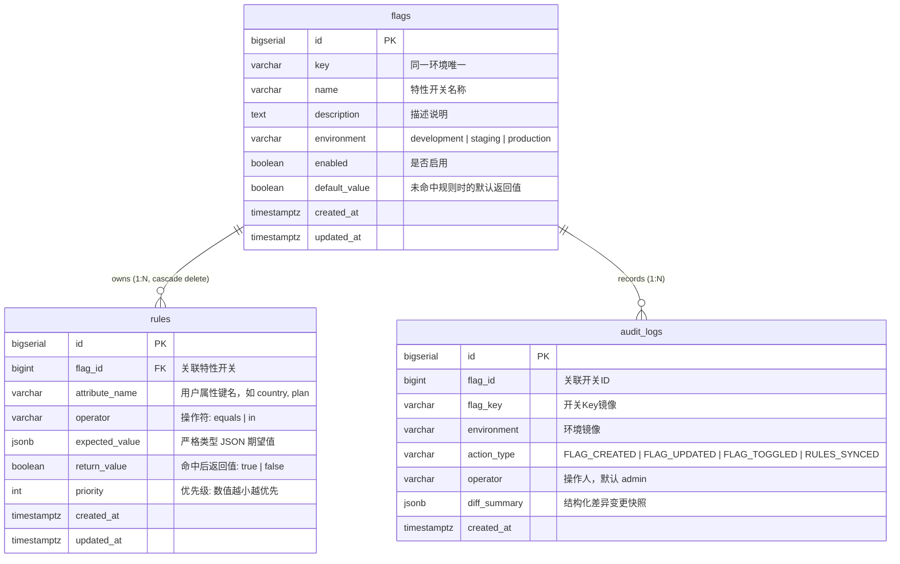

# Feature Flag 与灰度规则管理平台

[](https://go.dev/)
[](https://react.dev/)
[](https://www.postgresql.org/)

本项目是一个轻量、高可靠的 **Feature Flag 与有序灰度规则管理平台**。系统支持多环境隔离的特性开关管控、基于多属性的有序规则确定性评估、全生命周期的原子事务审计追踪，并提供零 Mock 的全栈交互界面与在线评估控制台。

---

## 目录
- [一、快速开始](#一快速开始)
  - [方法 1：Docker Compose 一键启动 (推荐)](#方法-1docker-compose-一键启动-推荐)
  - [方法 2：本地开发环境直接运行](#方法-2本地开发环境直接运行)
  - [自动化测试执行](#自动化测试执行)
- [二、核心业务语义与规则设计](#二核心业务语义与规则设计)
  - [1. 规则优先级策略](#1-规则优先级策略)
  - [2. 匹配操作符语义与严格类型隔离](#2-匹配操作符语义与严格类型隔离)
  - [3. 停用熔断语义 (Short-circuit)](#3-停用熔断语义-short-circuit)
  - [4. 重复优先级确定性策略](#4-重复优先级确定性策略)
- [三、系统架构与数据模型](#三系统架构与数据模型)
  - [1. 分层架构设计](#1-分层架构设计)
  - [2. 数据表模型 (ER)](#2-数据表模型-er)
- [四、架构设计取舍 (Design Trade-offs)](#四架构设计取舍-design-trade-offs)
- [五、已完成功能与验收清单](#五已完成功能与验收清单)
- [六、未完成项与已知限制](#六未完成项与已知限制)
- [七、AI 协同开发记录说明](#七ai-协同开发记录说明)

---

## 一、快速开始

### 方法 1：Docker Compose 一键启动 (推荐)

项目已提供完整的生产级容器编排。只需一条命令即可拉起 PostgreSQL 数据库、Go 后端与 Nginx 托管的前端服务：

```bash
docker compose up --build -d
```

* **前端管理平台**：访问 [http://localhost:3000](http://localhost:3000)（统一反代 `/api/` 路由，无跨域阻碍）
* **后端健康检查**：访问 [http://localhost:8080/health](http://localhost:8080/health)
* **默认演示数据**：服务首次拉起时，已通过幂等种子自动载入 4 组经典场景的 Flag、规则与初始审计历史。

停止容器：
```bash
docker compose down -v
```

---

### 方法 2：本地开发环境直接运行

#### 环境依赖
* Go 1.25+
* Node.js 18+ & npm
* PostgreSQL 14+ (创建数据库 `feature_flag_db`)

#### 1. 启动后端 (Go + Gin)
```bash
# 1. 进入后端目录
cd backend

# 2. 设置数据库连接（默认使用本地 postgres，可根据需要调整）
export DATABASE_URL="host=localhost port=5432 user=postgres password=postgres dbname=feature_flag_db sslmode=disable"

# 3. 运行服务（自动执行迁移与演示数据加载）
go run ./cmd/server
```
后端服务将在 `http://localhost:8080` 启动。

#### 2. 启动前端 (Vite + React)
```bash
# 1. 打开新终端，进入前端目录
cd frontend

# 2. 安装依赖并启动
npm install
npm run dev
```
前端开发服务器将在 [http://localhost:3000](http://localhost:3000) 运行，自动将 `/api` 请求代理至后端 8080 端口。

---

### 自动化测试执行

项目采用单元测试与集成测试双重保障，测试覆盖率高且全量通过：

```bash
# 运行后端全量测试套件（引擎、服务、控制器）
cd backend && go test -v -count=1 ./...

# 运行前端组件与页面集成测试
cd frontend && npm test
```

真实浏览器端到端冒烟（Playwright + 系统 Chrome，需先拉起 Compose 全栈）：

```bash
# 若本机 5432 已被占用，用 e2e 覆盖文件把容器库改映射到 15432
docker compose -f docker-compose.yml -f docker-compose.e2e.yml up -d --build

cd frontend && npx playwright test
```

冒烟用例动态创建 `smoke_*` Flag（不硬编码 id），覆盖深链直达、Nginx `try_files` 刷新回退、浏览器前进后退、`beforeunload` 防误关与全局审计台。

---

## 二、核心业务语义与规则设计

### 1. 规则优先级策略
* **方向定义**：**数值越小优先级越高**（`1` 为最高优先级，升序依次评估）。
* **匹配决策**：评估引擎按照 Priority 从小到大遍历规则。**第一条命中的规则立即决定最终返回值**，后续规则不再计算（Short-circuit）；若所有规则均未命中，则回退使用当前 Flag 的默认返回值 (`default_value`)。

### 2. 匹配操作符语义与严格类型隔离
规则支持 `equals` 和 `in` 两个操作符，底层采用 **严格 JSON 类型隔离与高精度匹配**，坚决杜绝 JavaScript 式的隐式跨类型弱转换：
* **`equals` 操作符**：
  * **字符串匹配**：只有在 Context 值为 string 且期望值为 string 时才进行值比对（例如 `"CN"` equals `"CN"` 为 true，`"1"` equals `1` 为 **false**）。
  * **布尔匹配**：严格布尔类型比对（`true` equals `true`）。
  * **数值匹配**：采用 Go 原生 `*big.Rat` 有理数高精度比对，整数与浮点数只要数学数值完全一致即可命中（例如 `3` equals `3.0` 为 true，支持超大整数如 `9007199254740993`）。
* **`in` 操作符**：
  * 期望值必须为 JSON 数组。
  * 逐项按 scalar 标量比对规则检查上下文属性是否存在于数组中。

### 3. 停用熔断语义 (Short-circuit)
* 当特性的启用状态为 **停用 (`enabled: false`)** 时，无论规则如何配置、无论默认值是 true 还是 false，**评估结果始终强制返回 `false`**。
* 评估诊断原因明确标记为 `FLAG_DISABLED`。

### 4. 重复优先级确定性策略
* **后端决策**：同一 Flag 下**严格禁止重复优先级**。数据库层建有联合唯一索引 `uq_rules_flag_priority (flag_id, priority)`；API 层接收到冲突输入时立即拒绝并返回统一结构化错误 `PRIORITY_CONFLICT`。
* **前端交互协同**：前端规则配置工作台提供平滑的「上移」「下移」控制，自动维持 `1..N` 连续无冲突优先级序列，并通过批量同步接口原子提交。

---

## 三、系统架构与数据模型

### 1. 分层架构设计
后端遵循整洁架构（Clean Architecture）原则，依赖方向单向流动：
`Handler (HTTP / Web)` ➔ `Service (Business & Atomic Tx)` ➔ `Repository (Data Access)` ➔ `PostgreSQL`
* **引擎纯洁性 (Engine Purity)**：规则评估引擎 [`internal/engine`](backend/internal/engine) 为**纯内存计算模块**，零外部 I/O 与网络依赖，保证亚毫秒级纯 CPU 求值性能。

### 2. 数据表模型 (ER)



#### 关键约束保障
* **同一环境 Key 唯一**：数据库级物理约束 `CONSTRAINT uq_flags_key_env UNIQUE (key, environment)`。不同环境可以复用相同的 Key。
* **规则优先级唯一**：数据库级物理约束 `CONSTRAINT uq_rules_flag_priority UNIQUE (flag_id, priority)`。

---

## 四、架构设计取舍 (Design Trade-offs)

1. **批量规则同步 Diff 算法 vs 单条增删改接口**
   * *决策*：采用整组规则状态同步 `PUT /api/v1/flags/:id/rules`。
   * *理由*：规则具有强序性与相互依赖（如优先级调序）。如果采用单条 CRUD，在调整规则顺序时会出现复杂的中间不一致状态；批量同步允许后端在单一事务内进行状态 Diff，一次性计算出 Added / Updated / Deleted，并通过临时优先级偏移算法（`+1,000,000`）优雅解决优先级对调时的瞬态唯一键冲突。
2. **物理数据库事务保证原子审计**
   * *决策*：开关创建、修改、启停与规则同步等全部写操作，与 `audit_logs` 的写入**强制置于同一个物理数据库事务 (`WithTransaction`) 中**。
   * *理由*：坚决杜绝“业务修改成功但审计丢失”或“审计记录写入但业务操作回滚”的脏状态。任何一步出错全量回滚。
3. **统一 RFC-7807 错误信封与零 Mock 前端**
   * *决策*：所有 HTTP 响应统一遵循 `{ "code": "...", "message": "...", "data": ... }`。前端无任何 Mock 假数据兜底，全部操作直接通过 API 与后端及 PostgreSQL 真实交互。
   * *理由*：保障前后端契约的一致性，确保在面对非法输入、Key 冲突、规则优先级冲突等场景时，前端能给出精准的表单定位与警示反馈。

---

## 五、已完成功能与验收清单

| 题目考核维度 | 具体要求 | 落实情况 |
| :--- | :--- | :--- |
| **Flag 管理** | 字段完整（名称/Key/环境/启停/默认值/时间） | 全部字段严格映射并持久化 |
| | 同环境 Key 唯一，跨环境可复用 | 数据库唯一约束 + 冲突结构化报错 (`FLAG_KEY_CONFLICT`) |
| | 列表/搜索/新建/编辑/启停/查看详情 | 支持环境 Tag 过滤、模糊搜索、全屏详情工作台与一键 Toggle |
| **有序匹配规则** | 属性名、`equals` / `in`、期望值、返回值、优先级 | 支持全部属性与操作符，JSONB 原生严格类型比对 |
| | 优先级方向与语义清晰 | 数值越小越优先，首条命中即终止，未命中回退默认值 |
| | 停用始终返回 false | 引擎第一行进行短路熔断，返回 `false` 与 `FLAG_DISABLED` |
| | 优先级冲突确定性处理 | 后端冲突拒绝 (`PRIORITY_CONFLICT`)，前端提供平滑位移调整 |
| **在线评估控制台** | 交互输入 Key、环境、JSON 上下文 | 提供独立页面，内置 JSON 实时校验、快速填充与一键格式化 |
| | 诊断结果展示清晰 | 明确显示最终返回值、命中规则 ID 及条件、降级原因等 |
| | 错误精准反馈 | JSON 格式错误实时标红提示，Flag 不存在给出明确告警 |
| **操作历史** | 创建、修改、增删改规则、启用或停用 | 后端按类型完整记录并落库结构化变更 Diff 快照；前端「变更历史」Tab 时间轴与全局审计台由 Ticket 08A/08B 交付，当前为占位 |
| | 变更与历史原子一致 | 强制使用数据库物理事务同时提交，同成功同失败 |
| **工程质量** | 数据库迁移与演示数据 | 包含 init 迁移脚本与自动加载的 4 组经典场景种子数据 |
| | 自动化测试套件 | 后端全量 Go 单元/集成测试 + 前端 52 项页面级集成测试（7 个测试文件）全通过 |
| | 交付件齐备 | 包含标准 README、Docker Compose 编排与 AI 协同日志 |

---

## 六、未完成项与已知限制

根据 48 小时测试题的工期建议（实际投入 6~8 小时）以及优先保障核心交付链路的原则，以下内容作为已知限制说明：

1. **未实现完整用户与权限认证系统 (RBAC)**：
   * *说明*：根据题面“本题不要求实现完整登录系统，可使用固定操作者”的要求，当前系统将操作人固定为 `admin` / `system_seed`。若要在生产环境使用，可在路由层前置接入 JWT / SSO 中间件。
2. **百分比灰度暂未集成哈希散列算法**：
   * *说明*：当前系统已完全满足题面要求的 `equals` 和 `in` 基于属性的精准规则匹配。对于“按用户 ID 哈希进行 10%~50% 阶梯放量”的场景，可通过在引擎扩展一个 `percentage` 操作符与 Murmur3 哈希函数实现，目前作为后续演进方向。
3. **高并发缓存预热与推送**：
   * *说明*：当前架构专为轻量级管理平台设计，每次评估请求在服务层实时加载当前 Flag 及其规则至内存进行求值。在超大规模高并发调用场景下，可引入 Redis 分布式缓存或通过 WebSocket / gRPC 向客户端 SDK 广播规则快照。
4. **变更历史与全局审计台前端待交付**：
   * *说明*：审计数据在后端已完整落库（含结构化 Diff 快照），前端 `/flags/:id?tab=audit` 目前为占位文案，时间轴与 Diff 展开由 Ticket 08A 交付，全局审计台由 Ticket 08B 交付；真实浏览器端到端冒烟（Ticket 09）亦未执行。

---

## 七、AI 协同开发记录说明

本项目严格按照测试题规范，全流程记录了 AI 辅助开发的交互历史与设计决策过程。详细记录已整理归档在：
👉 **[`docs/ai/AI_COLLABORATION_LOG.md`](docs/ai/AI_COLLABORATION_LOG.md)**

内容涵盖各阶段 Prompt 核心诉求、架构决策权衡轨迹、以及 AI 在代码一致性与防御性设计层面的具体实践。
